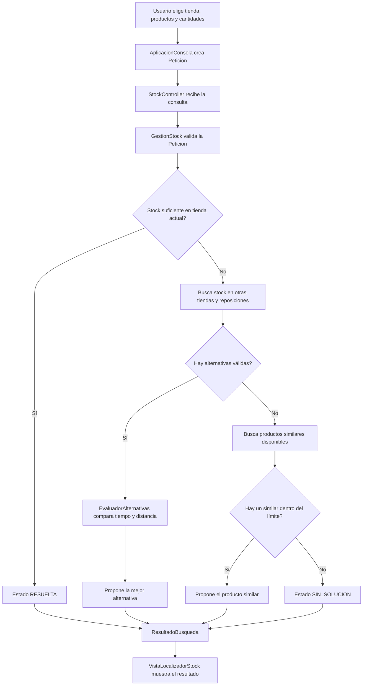

# Guía para probar la aplicación de consola

Esta guía muestra cómo ejecutar la demo, qué opciones introducir para comprobar cada resultado posible y qué lógica produce la respuesta. La demo usa datos en memoria; no consulta una base de datos.

## Ejecutar desde Eclipse

1. Abre `src/main/java/app/AplicacionConsola.java`.
2. Haz clic derecho y selecciona **Run As > Java Application**.
3. Escribe las opciones en la vista **Console** de Eclipse.

Al iniciar, el menú ofrece `1) Nueva búsqueda` y `0) Salir`. En cada búsqueda se introduce, en este orden: la opción del menú, el número de la tienda, el número del producto, la cantidad y `n` cuando no se quieran añadir más productos.

El catálogo aparece ordenado por código de producto. Después de cada resultado, la aplicación vuelve al menú principal. Al terminar todos los casos, escribe `0` para salir.

## Tiendas de la demo

Las coordenadas se muestran al elegir la tienda actual.

| Opción | Tienda | Latitud | Longitud |
|---:|---|---:|---:|
| 1 | Centro | 41.3870 | 2.1700 |
| 2 | Norte | 41.3970 | 2.1700 |
| 3 | Sur | 41.3770 | 2.1700 |
| 4 | Far | 41.5500 | 2.1700 |

`Far` está a unos 18 km de Centro, por encima del máximo de 10 km.

## Productos y stock de ejemplo

| Opción | Producto | Centro | Norte | Sur | Far |
|---:|---|---:|---:|---:|---:|
| 1 | Camiseta básica | 1 | 5 | 0 | 0 |
| 2 | Pantalón de vestir | 1 | 0 | 0 | 0 |
| 3 | Chaqueta roja | 0 | 0 | 0 | 2 |
| 4 | Chaqueta azul | 0 | 0 | 5 | 0 |
| 5 | Botas de montaña | 0 | 0 | 0 | 2 |

El proveedor de reposición de la demo anuncia 2 unidades para Camiseta básica y Pantalón de vestir en Centro, aproximadamente 45 minutos después de la solicitud.

## Casos para probar

Empieza cada caso desde el menú principal. La secuencia indica: **menú → tienda → producto → cantidad → añadir otro producto**.

### 1. Stock suficiente en la tienda actual

Secuencia:

```text
1 → 1 → 1 → 1 → n
```

Selecciona Nueva búsqueda, Centro, Camiseta básica y cantidad 1. El stock de Centro ya cubre esa cantidad, así que no se buscan alternativas.

Salida esperada:

```text
Camiseta básica x 1: resuelta en la tienda actual.
```

Estado: `RESUELTA`.

### 2. Alternativa en otra tienda

Secuencia:

```text
1 → 1 → 1 → 3 → n
```

Solicita 3 Camisetas básicas en Centro. Allí hay 1 unidad, así que faltan 2. Norte tiene 5 unidades y queda dentro del límite de distancia. También existe una reposición de 2 unidades, pero el evaluador compara ambas opciones.

Norte queda aproximadamente a 1,1 km y el estimador de la demo calcula unos 3 minutos. La puntuación aproximada es `0,0505`; la reposición de 45 minutos y 0 km obtiene `0,2625`. Como una puntuación menor es mejor, se propone Norte.

Salida esperada:

```text
Camiseta básica x 3: recoger en Norte (3 min, 1.1 km).
```

Estado: `ALTERNATIVA_PROPUESTA`.

### 3. Reposición

Secuencia:

```text
1 → 1 → 2 → 3 → n
```

Solicita 3 Pantalones de vestir en Centro. Hay 1 unidad en stock y no hay otra tienda cercana con ese producto. La reposición ofrece las 2 unidades que faltan y llega dentro del plazo permitido.

Salida esperada, con la fecha y hora de ejecución de la demo:

```text
Pantalón de vestir x 3: esperar reposición en Centro (aprox. 45 min, 2 unidades, <fecha y hora>).
```

Estado: `ALTERNATIVA_PROPUESTA`.

### 4. Producto similar

Secuencia:

```text
1 → 1 → 3 → 1 → n
```

Solicita una Chaqueta roja en Centro. El producto original solo está en Far, fuera del límite de 10 km, y no tiene reposición prevista. La búsqueda pasa a productos similares y encuentra Chaqueta azul en Sur. Coinciden tipo y género; el color cambia. La similitud es `2 de 3`, es decir, `66.7 %`.

Salida esperada:

```text
Chaqueta roja x 1: producto similar: Chaqueta azul en Sur (66.7%, 3 min, 1.1 km).
```

Estado: `ALTERNATIVA_PROPUESTA`.

### 5. Ninguna solución

Secuencia:

```text
1 → 1 → 5 → 1 → n
```

Solicita unas Botas de montaña en Centro. El producto original solo está en Far, fuera del límite de distancia; no hay reposición y los productos cercanos no coinciden en tipo, género ni color.

Salida esperada:

```text
Botas de montaña x 1: no se encontró una solución.
```

Estado: `SIN_SOLUCION`.

## Flujo desde la petición hasta el resultado



## Regla de estimación de viaje en la demo

La demo no calcula rutas por carretera. Usa la distancia geográfica y estima el tiempo con una velocidad fija aproximada de 30 km/h (`2 minutos por kilómetro`). Por eso los tiempos y la hora concreta de reposición son ejemplos, no datos de navegación en tiempo real.
