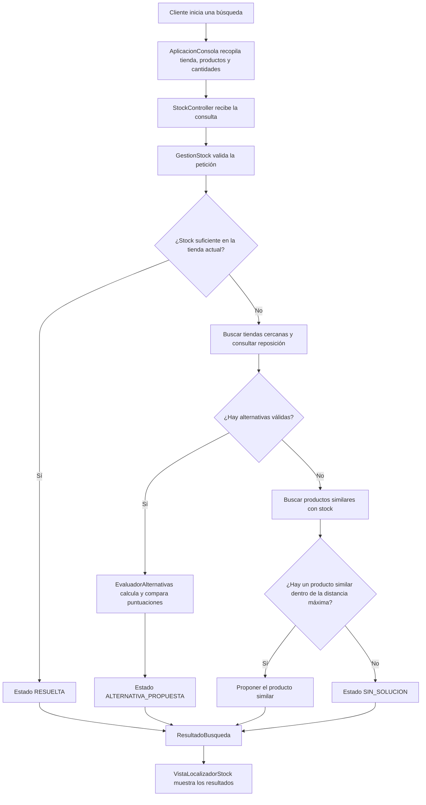

# Localizador de stock

## Propósito

El sistema recibe una petición con uno o varios productos y cantidades. Para cada línea decide si la tienda actual puede cubrirla. Si falta stock, busca una alternativa cercana, una reposición prevista o, cuando no encuentra ninguna de ellas, un producto similar.

La primera versión incluye una aplicación de consola con tiendas y productos de ejemplo en memoria. No usa una base de datos ni calcula rutas reales.

## Flujo de una petición

El cliente elige una tienda, añade productos y cantidades, y envía la petición. `GestionStock` resuelve cada línea por separado:

1. Valida que la petición tenga líneas válidas y cantidades positivas.
2. Consulta el stock de la tienda actual. Si cubre la cantidad, marca la línea como `RESUELTA`.
3. Si falta stock, busca otras tiendas cercanas que tengan la cantidad solicitada y consulta la reposición prevista para la tienda actual.
4. Valida las alternativas y elige la de menor puntuación.
5. Si no hay una alternativa válida, busca productos similares con stock dentro del límite de distancia.
6. Si tampoco encuentra un producto similar válido, marca la línea como `SIN_SOLUCION`.
7. `VistaLocalizadorStock` muestra el estado y, cuando existe, la mejor alternativa.

Una petición puede contener varias líneas y cada una puede acabar en un estado distinto. `ResultadoBusqueda.estaResuelta()` devuelve `false` si alguna línea está `SIN_SOLUCION`; las líneas `RESUELTA` y `ALTERNATIVA_PROPUESTA` cuentan como resueltas.



## Arquitectura MVC

- **Vista:** `VistaLocalizadorStock` muestra los estados y detalles de las alternativas.
- **Controlador:** `StockController` recibe la petición y delega en `GestionStock`.
- **Modelo:** `GestionStock` coordina validación, búsqueda, reposición, comparación y búsqueda de similares.
- **Aplicación de consola:** `AplicacionConsola` recopila las opciones del usuario y conecta el controlador con los servicios y los datos de demostración.

Servicios principales del modelo:

- `ValidadorPeticion` valida peticiones y reposiciones.
- `BuscadorTiendas` busca tiendas con stock y calcula distancia y tiempo estimado.
- `ServicioReposicion` consulta `ProveedorReposicion` para obtener la reposición prevista.
- `EvaluadorAlternativas` descarta opciones que incumplen restricciones y elige la mejor puntuación.
- `PoliticaBusqueda` calcula la puntuación ponderada de las alternativas.
- `BuscadorProductosSimilares` compara familia/tipo, género y color, y comprueba el stock.

## Restricciones y selección de alternativas

Las restricciones obligatorias implementadas son:

- **Distancia máxima:** 10 km para una alternativa en otra tienda y para un producto similar.
- **Espera máxima por reposición:** 120 minutos. La reposición también debe cubrir la cantidad que falta y no puede tener una fecha anterior a la solicitud.
- **Stock en otra tienda:** debe cubrir toda la cantidad solicitada.
- **Stock en la tienda actual:** si cubre la línea completa, no se buscan otras opciones para esa línea.

Las opciones que incumplen una restricción se descartan antes de elegir la mejor alternativa.

### Puntuación ponderada

`PoliticaBusqueda` asigna un peso del **70 % al tiempo** y del **30 % a la distancia**. Normaliza el tiempo respecto a 120 minutos y la distancia respecto a 10 km:

```text
puntuacion = 0.70 × (tiempoEstimadoMinutos / 120)
           + 0.30 × (distanciaKm / 10)
```

Una puntuación menor representa una opción más conveniente. La puntuación no es una probabilidad: expresa el coste relativo de tiempo y distancia según estos pesos. Si dos alternativas empatan exactamente, se prefiere la de menor tiempo y, después, la de menor distancia.

Ejemplo aproximado:

| Alternativa | Tiempo | Distancia | Cálculo | Puntuación |
|---|---:|---:|---|---:|
| Recoger en otra tienda | 3 min | 1,1 km | `0,70 × 3/120 + 0,30 × 1,1/10` | `0,0505` |
| Esperar reposición | 45 min | 0 km | `0,70 × 45/120 + 0,30 × 0/10` | `0,2625` |

En este ejemplo se propone recoger en la otra tienda porque su puntuación es menor.

### Similitud de productos

La similitud compara tres características: tipo/familia, género y color. Cada coincidencia aporta un tercio del porcentaje:

```text
similitud = (características coincidentes / 3) × 100
```

Por ejemplo, dos chaquetas del mismo género, pero de distinto color, coinciden en 2 de 3 características y obtienen `66,7 %`. La búsqueda de similares se usa como último recurso después de tiendas y reposición. Los resultados se ordenan por similitud descendente; los empates se ordenan por código de producto y luego por identificador de tienda.

## Estimación del tiempo

`CalculadorDistanciaGeografica` calcula distancia geográfica a partir de las coordenadas. `EstimadorTiempoViaje` proporciona minutos estimados por separado; no se calcula una ruta por carretera.

En la demo, el estimador aplica una aproximación fija de 2 minutos por kilómetro, equivalente a unos 30 km/h. Es un valor ilustrativo, no una estimación de navegación en tiempo real.

## Ejecutar la demo

### Desde Eclipse

1. Abre `src/main/java/app/AplicacionConsola.java`.
2. Selecciona **Run As > Java Application**.
3. Usa la vista **Console** para introducir las opciones.

### Desde PowerShell

Desde la carpeta del proyecto:

```powershell
mvn compile
java -cp target/classes app.AplicacionConsola
```

El menú permite iniciar una búsqueda, elegir tienda, seleccionar uno o varios productos y escribir sus cantidades. Las opciones inválidas se vuelven a solicitar.

La demo incluye casos de stock en la tienda actual, alternativa en otra tienda, reposición, producto similar y ausencia de solución. Consulta [GUIA_PRUEBA_CONSOLA.md](GUIA_PRUEBA_CONSOLA.md) para ver las secuencias de entrada y las salidas esperadas de cada caso.

## Ejecutar las pruebas

Desde la raíz del proyecto:

```powershell
mvn clean test
```

Los tests cubren las clases del dominio, las restricciones, la búsqueda, la selección de alternativas, la integración de `GestionStock`, el controlador, la vista.
